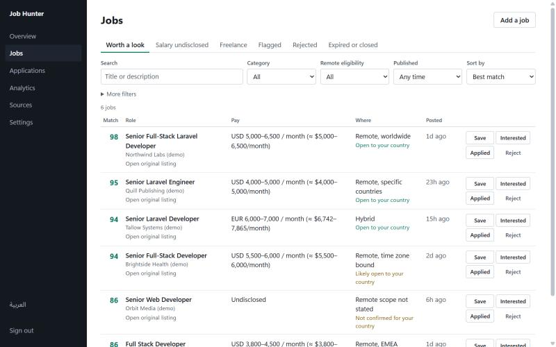

# CanIApply

**"Remote" often doesn't include your country.** CanIApply reads remote job posts, works out whether you can actually apply from where you live, and shows you the sentence that proves it.

It runs on your own machine, needs no API key, and never applies to anything for you.



## Why

Most remote boards let you filter by "Remote". Then you read the post, and line 14 says *must be authorized to work in the United States*. If you live outside the US and the EU, you lose hours to that.

CanIApply treats that line as the most important one in the post.

| The post says | Your country | Verdict |
|---|---|---|
| "You must be located in the United States" | Egypt | Excludes your country, and it quotes the sentence |
| "You must be located in the United States" | United States | Open to your country |
| Location: `EMEA` | Germany | Likely open, because your region is named |
| Location: `EMEA` | India | Excluded |
| Location: `Worldwide`, "must overlap with EST hours" | Egypt | Likely open, flagged as time zone bound |
| Just "Remote" | Any | Not confirmed. It never guesses "worldwide" |

## What it does

- **Collects** jobs from public APIs, feeds and company career pages, and merges duplicates.
- **Decides who can apply** for 78 countries, in English and Arabic posts.
- **Scores** each job out of 100 for your skills, seniority, pay, eligibility and the work itself. You set the weights.
- **Never invents a salary.** An undisclosed salary is shown as undisclosed.
- **Tells you on Telegram** when something scores high, and sends a daily digest for the rest.
- **Tracks** what you applied to, in a private dashboard, in English or Arabic.
- **Learns** a little from what you accept and reject, within a limit you control.

It does not apply for you, write to employers, or get around a site that blocks automated reading. For a job on a site like that, paste it into "Add a job" and it gets the same scoring.

## Quick start

You need PHP 8.3 and Composer.

```bash
git clone https://github.com/imsemoo/caniapply.git
cd caniapply
composer setup
php artisan hunter:install --demo
php artisan serve
```

`hunter:install` asks for your country, then prints your login. `--demo` loads eight made-up jobs, so that you can look around right away. They disappear by themselves when the first real job arrives.

To collect real jobs, keep these two running in other terminals:

```bash
php artisan queue:work
```

```bash
php artisan schedule:work
```

They search every few hours. To search right now and see the results straight away, run `php artisan hunter:discover --now`. A source searched in the last few hours is skipped, so add `--force` to search it again.

### With Docker

```bash
HUNTER_COUNTRY="Germany" docker compose up --build
```

Open <http://localhost:8000>. Your login is in a file inside the container:

```bash
docker compose exec app cat storage/first-login.txt
```

## Make it yours

The defaults describe a web developer, so change them first. Under **Settings** you set your country, skills, searches, salary floor and score weights.

To add a country, add one row to `app/Support/HomeCountry.php`. To add a job source, add one class in `app/Sources/Connectors` and one line in `config/hunter.php`.

For Telegram alerts, make a bot with @BotFather, then run `php artisan hunter:telegram --setup`.

## Sources

Himalayas, Jobicy, Remote OK, We Work Remotely, Remotive, Arbeitnow, LaraJobs and VueJobs, plus company pages on Greenhouse, Ashby, Lever, Recruitee and Workable.

**This is a tool for your own job search.** Each source has its own terms, and several do not allow commercial use or republishing. If you build a product on this code, get permission from each source first. You can switch any source off under **Sources**.

LinkedIn, Indeed and Glassdoor are not connected, because they do not allow automated reading.

## Limits

- The eligibility rules are pattern matching on text. They make mistakes, so read the quoted sentence before you trust a verdict.
- It is built for one person on one machine. If you put it on the internet, use HTTPS and set `APP_ENV=production` and `APP_DEBUG=false` first.
- A country has one UTC offset here, so time zone notes are rough for large countries.
- Freelance scoring works, but no freelance marketplace is connected. It applies to projects you add yourself.

## العربية

تقرأ الأداة إعلانات الوظائف عن بعد، وتخبرك هل يمكنك التقديم من بلدك فعلًا، وتعرض الجملة من الإعلان التي تثبت ذلك. الواجهة متاحة بالعربية، وتفهم الإعلانات العربية أيضًا.

## License

MIT. Built by Islam Nasser ([GitHub](https://github.com/imsemoo)).
